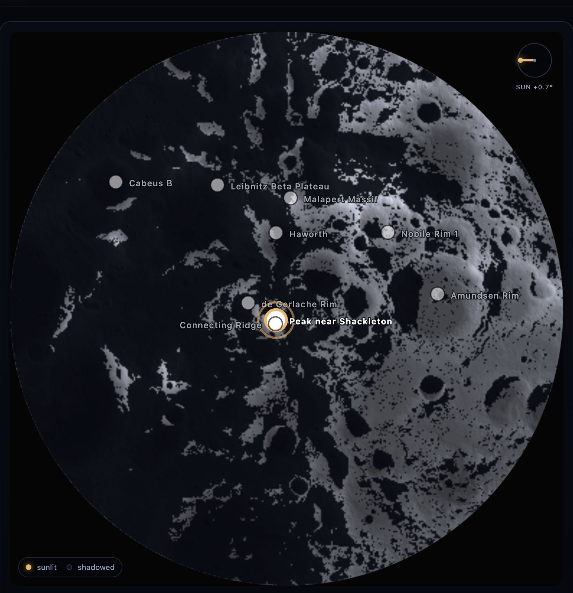

# SUNLOCK

**Find the week the Sun comes back.**

A landing-window navigator for the lunar south pole, built for the
[NASA Space Apps Challenge 2026](https://www.spaceappschallenge.org/2026/challenges/lunar-landing-site-navigator/)
challenge *Lunar Landing Site Navigator*.

**Live:** https://shahaman098.github.io/sunlock/
**Demo (7 slides):** https://shahaman098.github.io/sunlock/demo/sunlock-demo.pdf



---

## The problem

At the lunar south pole the Sun never rises more than about **1.5°** above the horizontal.
Lighting is therefore controlled almost entirely by local terrain: a crater rim a few hundred
metres away can hold a site in darkness for days while its neighbour stays lit.

Earth sits low as well, and libration swings it through roughly **±7°**, so direct-to-Earth
communication windows open and close on a timescale of days. Power and communications drive the
whole mission architecture, which makes these two numbers the first thing a planner needs.

Existing tools exist — but they are SPICE scripts, GIS layers and research interfaces. Comparing
several candidate regions across a season is an afternoon of work per question.

## What it does

- **Terrain-driven shadow map.** Scrub time and the shadow pattern across the entire pole is
  recomputed from the elevation model, not played back from a texture.
- **Nine candidate regions**, each optimised to its best local high ground within the region.
- **Click anywhere** on the map and that point is analysed with the same horizon test, using a
  1024² elevation grid (~600 m/px) shipped to the browser.
- **Four decision numbers per site:** sunlight fraction, longest continuous darkness,
  direct-to-Earth visibility, surface elevation.
- **Window finder.** Ranked, non-overlapping landing windows for a chosen mission length.

## How it works

1. **Terrain** — NASA LRO LOLA south polar gridded elevation model `LDEM_80S_80M`
   (80 m/pixel, 7,600 × 7,600 samples), decoded from its PDS product and re-projected from the
   original polar stereographic grid.
2. **Local horizon** — from each point, ray-marched along 360 azimuths out to 64 km, with the
   lunar curvature drop subtracted.
3. **Ephemeris** — Sun and Earth directions rotated into the lunar body-fixed frame using the
   IAU 2015 rotation model, including the 1.54° axial tilt and libration.
4. **Decision** — a point is sunlit when solar elevation clears its terrain horizon; the Earth
   link is counted while Earth is above the skyline (allowing its ~0.95° angular radius).

The map applies the same test at every pixel of a 384 × 384 grid.

### Benchmarks

See [BENCHMARKS.md](BENCHMARKS.md) for the full set: agreement with JPL Horizons on geometry
(21″) and on the lunar frame (0.003° in longitude), the effect of the Sun's finite disc (0.40%),
position sensitivity (±250 m → σ 0.04%) and horizon-sampling sensitivity (1.02% worst case).

```bash
cd web
npm run verify   # JPL Horizons: geometry + frame
npm run bench    # sensitivity of the illumination numbers
```

### Independent verification

The sky geometry is compared against **JPL Horizons** at 12 epochs across the 2027 window
(astrometric RA/Dec, observer = Moon centre):

```
node web/scripts/verify-horizons.mjs
```

Result: maximum difference **0.0058°** for the Sun and **0.0063°** for Earth — about 23 arcseconds,
the level of aberration and light-time treatment rather than of geometry, and two orders of
magnitude below the 80 m terrain resolution. Output is committed at
`web/public/terrain/verification.json` and shown in the app's method panel.

### Validation

- The projection is checked against known relief: Malapert Massif is high, the Cabeus floor is
  deep, and Shackleton crater appears at the correct offset with a 21 km diameter.
- The lunar frame is checked against physical libration: the sub-Earth point stays within ~±7°
  of the prime meridian.
- **86% illumination** at the peak near Shackleton over 180 days — inside the published
  80–86% range for the best south-pole locations.

## Limitations

No atmospheric refraction, no thermal or power-system model, no terrain self-shadowing between
distant peaks, no physical libration, 80 m terrain resolution. Custom clicked points are ray-marched
on the 1024² grid (~600 m/px), which is coarser than the 80 m model used for the preset regions. This is a planning aid for
comparison and intuition, not a flight-qualified analysis tool.

## Run it

```bash
cd web
npm install
npm run dev
```

Terrain assets are committed under `web/public/terrain/`. To rebuild them from the raw DEM:

```bash
curl -O https://pds-geosciences.wustl.edu/lro/lro-l-lola-3-rdr-v1/lrolol_1xxx/data/lola_gdr/polar/img/ldem_80s_80m.img
mkdir -p data/raw && mv ldem_80s_80m.img data/raw/
node scripts/build-terrain.mjs
```

## Data and credits

- **LRO LOLA** gridded south polar DEM, product `LDEM_80S_80M`, NASA Planetary Data System
  Geosciences Node (LRO-L-LOLA-4-GDR-V1.0). Modelling by the LOLA team at NASA Goddard.
- **Astronomy Engine** (MIT) — ephemeris and lunar rotation model.
- **IAU WGCCRE 2015** — cartographic and rotational elements.
- React, TypeScript, Vite.

## Licence

MIT. NASA data is used under its public-domain terms; please credit LRO LOLA.
