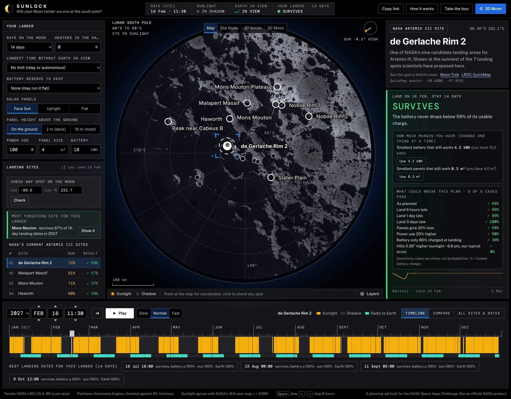
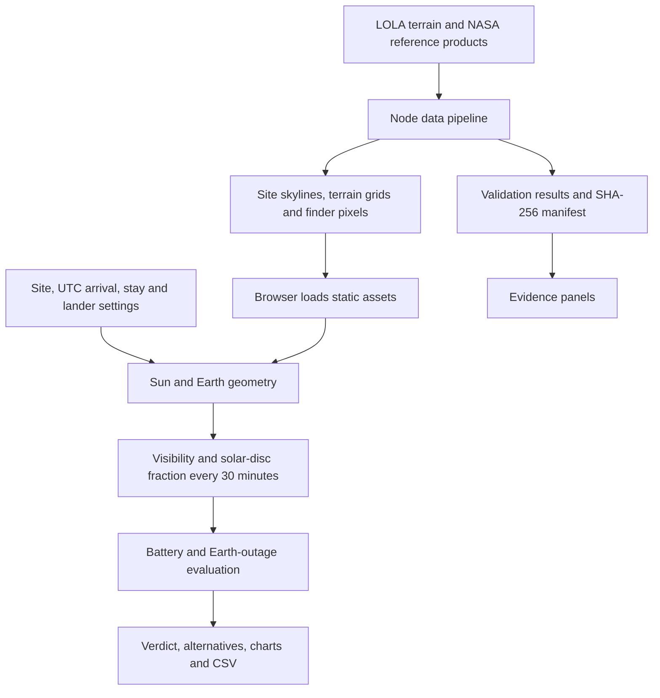

# SUNLOCK

**Check whether a lunar lander survives a chosen site, arrival time and surface stay, then find a change that makes the plan work.**

[Open SUNLOCK](https://shahaman098.github.io/sunlock-app/) · [Seven-slide demo](https://shahaman098.github.io/sunlock-app/demo/sunlock-demo.pdf) · [Try the February landing](https://shahaman098.github.io/sunlock-app/#site=de-gerlache-rim-2&land=2027-02-16T11:30Z&days=14&load=100&array=4&battery=10)



Built for **NASA Space Apps Challenge 2026**, *Lunar Landing Site Navigator*.

## The problem

A lunar south-pole mission depends on when sunlight reaches its panels and when Earth clears the local skyline. Terrain can hide the Sun for days, and a long-term illumination average alone cannot tell a team whether its battery lasts through a particular stay.

SUNLOCK is for early mission comparisons, educators and people exploring lunar operations. It connects a location and arrival time to a concrete decision about power and Earth visibility. NASA's terrain and illumination products provide the measurements and reference maps behind that decision. [Challenge](https://www.spaceappschallenge.org/2026/challenges/lunar-landing-site-navigator/) · [NASA polar illumination products](https://pgda.gsfc.nasa.gov/products/69)

## See the decision change

Use **de Gerlache Rim 2**, a **14-day stay**, **100 W** continuous load, **4 m²** of Sun-facing panels and a **10 kWh** battery. Keep panels at ground level, heaters at 0 W, battery reserve at zero and the Earth-outage requirement at “No limit.” The model starts with a fully charged battery and uses 80% depth of discharge.

| Landing time, UTC | Expected result |
|---|---|
| 4 February 2027, 00:00 | Battery reaches zero on 12 February at about 03:41 |
| 14 February 2027, 00:00 | Battery reaches zero on 17 February at 08:00 |
| 16 February 2027, 11:30 | Survives, with minimum usable charge of about 59% |

1. Open the [February example](https://shahaman098.github.io/sunlock-app/#site=de-gerlache-rim-2&land=2027-02-16T11:30Z&days=14&load=100&array=4&battery=10) and enter **Mission console**.
2. Compare the arrival dates above using the UTC clock. Read the verdict, battery curve and next sunrise.
3. On a failing landing, apply one suggested change to battery size, panel area or arrival time and check the resulting verdict.
4. Inspect the stress cases, then download the mission CSV or print its brief.

Arrival time matters. Landing at midnight on 16 February leaves about **44%** minimum usable charge, so reproducing the 59% example requires **11:30 UTC**.

## What is implemented

| Capability | Decision it supports | Implementation |
|---|---|---|
| Mission power evaluation | Does this lander last through this stay, and when does it fail? | One evaluator for verdicts, site rankings, date grids and sizing in [power.ts](web/src/lib/power.ts) |
| Landing dates and design changes | When could it land, or how much battery or panel area would it need? | Half-hour landing search, checked sizing values and one-at-a-time stress cases in [power.ts](web/src/lib/power.ts) |
| Site finder | Which locations meet sunlight, Earth visibility, slope and permanent-shadow-distance limits? | NASA reference pixels retained across the four constraints in [finder.ts](web/src/lib/finder.ts) |
| Terrain and sky views | Which hills block the Sun or Earth at this moment? | Globe, local 3D terrain, sky panorama and polar map in [components](web/src/components) |
| Evidence and exports | Can someone inspect the inputs, assumptions and result? | [CSV export](web/src/lib/export.ts), shared scenarios, method panels and [data provenance manifest](web/public/terrain/manifest.json) |

The app includes the nine Artemis III candidate regions announced in 2024, older candidate regions, and past and planned landing markers. Each current region is represented by a selected published location. Nearby alternatives have their own 80 m terrain skylines. Arbitrary clicked coordinates use a coarser grid and carry a preliminary label.

## How it works



**Terrain.** The named-site pipeline traces 360 skyline directions over NASA's `LDEM_80S_80M` elevation model, using bilinear samples every 40 m out to 150 km and accounting for lunar curvature. Raised-panel skylines are precomputed for supported sites. The overview shadow map uses a reduced grid and angular sampling. Arbitrary coordinates use roughly 600 m terrain detail. [Horizon calculation](scripts/lib/horizon.mjs) · [Site pipeline](web/scripts/select-sites.mjs) · [Browser terrain](web/src/lib/terrain.ts)

**Sky geometry.** Astronomy Engine supplies Sun and Earth positions. The IAU 2015 lunar rotation model includes periodic libration terms, and Earth visibility uses the observer's surface position. The skyline test accounts for the finite angular size of the Sun and Earth. [Geometry](web/src/lib/selene.ts)

**Mission evaluation.** Visible solar-disc fraction scales panel output. The evaluator applies panel orientation, constant load, optional heaters, usable battery capacity, reserve and an optional Earth-outage limit. Stress cases change arrival, panel output, power use, starting charge or terrain. Each case changes one assumption. [Mission model](web/src/lib/power.ts)

| Layer | Technology | Role |
|---|---|---|
| Interface | React, TypeScript | Mission settings, state and linked views |
| 3D views | three.js | Globe and local terrain rendering |
| Astronomy | Astronomy Engine | Ephemerides and lunar frame |
| Build and hosting | Vite, GitHub Pages | Static browser application |
| Data preparation | Node.js scripts | Terrain processing, validation and provenance |

Mission calculations run in the browser. Static hosting serves the app and prepared datasets. Running the app needs no API key or account.

## Evidence and results

The following values come from the committed validation outputs. Correlation describes agreement in illumination or visibility averages. Mission shadow timing is examined separately below.

| Comparison | Sample | Result | Evidence |
|---|---|---|---|
| Long-term sunlight against NASA LOLA map | 1,782 random points, 85–90°S | r = **0.990**, RMSE **1.88 percentage points** | [Validation](web/public/terrain/validation.json) |
| Permanent shadow against NASA LOLA map | 2,000 sampled points | Intersection over union **0.926** | [Validation](web/public/terrain/validation.json) |
| Earth visibility against NASA LOLA map | 1,471 points | r = **0.989**, RMSE **2.98 points** | [Validation](web/public/terrain/validation.json) |
| Sunlight against LROC's photograph-based annual map | 296 points, matching 2010–11 window | r = **0.980**, RMSE **3.09 points** | [LROC comparison](research/validation/result-wac.json) |
| Sun and Earth geometry against JPL Horizons | 12 epochs | Maximum differences **21.0″** for Sun and **22.7″** for Earth | [Verification](web/public/terrain/verification.json) |

The four map comparisons have recorded pass criteria in the validation output. At **105 published landing locations**, sunlight RMSE is **6.8 points**, larger than the random map sample's error. Region representatives were selected partly for agreement with NASA's map, so their shown values are also influenced by that selection rule. [Selection and per-site results](web/scripts/select-sites.mjs) · [Validation](web/public/terrain/validation.json)

### Shadow timing against photographs

An exploratory comparison uses **261 LROC frames from December 2009**, sampled at **1,793 positions** within 24 km of the pole. Across **467,973 samples**, a half-disc visibility rule agrees with photograph brightness on **96.6%**. An always-dark baseline scores **81.2%**. Bright-class intersection over union is **0.842**.

Of 1,802 photographed sunrise and sunset transitions, 1,519 have a model transition within 24 hours. Their median timing error is **0.5 hours**, while **283 transitions have no match** in that window. Frames are about 1.9 hours apart. With the app's any-part-of-disc rule, agreement is **95.4%** and the matched median timing error is **3.28 hours**.

For seven-day missions, the half-disc comparison agrees on survival in **95.9% of 50,204 cases**, against an always-fail baseline of 82%. Of the cases predicted to survive, **82.7%** also survive using photograph-derived sunlight in the same power model. The any-part-of-disc version gives **77.8%** on that last measure. These comparisons examine the light sequence feeding the power calculation. Photograph coverage could not support a continuous 14-day validation. [Full methods, confusion counts and limits](research/validation/result-wac-movie.json) · [Reproduction script](web/scripts/validate-wac-movie.mjs)

### Tests and reproducibility

The test suite covers geometry and coordinate round trips, JPL fixtures, battery depletion, partial sunlight, reserve and Earth-outage requirements, sizing, landing searches, nearby-site decisions and manifest hashes. Run it with `npm test` from `web`. Saved research results have their own reproduction commands below. [Tests](web/tests)

## Engineering challenges

- **Keeping the lunar frame and azimuth conventions consistent.** A horizon-direction error found during comparison required correcting the geometry. Coordinate round trips, known north/east directions and JPL fixtures now exercise these boundaries. [Geometry tests](web/tests/geometry.test.mjs)
- **Preserving useful finder locations.** Each map cell retains the reference pixels needed to cover tradeoffs in sunlight, Earth visibility, slope and distance to permanent shadow. Coordinates stay attached to their measurements. [Finder builder](web/scripts/build-finder.mjs)
- **Evaluating nearby alternatives.** A shortcut that adjusted a site's skyline using coarse terrain performed poorly. Nearby alternatives now have skylines traced at their own locations. Against NASA's long-term map, 96 nearby points give r = **0.961** and RMSE **3.77 points**. [Comparison](research/validation/nearby.json) · [Nearby builder](web/scripts/build-nearby.mjs)

These choices connect the challenge's terrain and illumination data to an inspectable mission decision. The 3D view introduces the location, while the console exposes the calculation and its evidence.

### Evidence for judging

| Space Apps criterion | What a reviewer can inspect |
|---|---|
| Impact | The February example turns an arrival-date choice into a power-survival decision for a specified lander. |
| Creativity | Mission settings connect terrain, changing sunlight and Earth visibility to suggested design or timing changes. |
| Validity | NASA reference comparisons, JPL fixtures, sample sizes, baselines and known errors are published alongside the model. |
| Relevance | LOLA terrain and LROC observations directly support the Lunar Landing Site Navigator challenge. |
| Presentation | The working app, seven-slide demonstration, screenshot and reproducible scenario show the same decision. |

## Getting started

Use **Node.js 24 LTS** and npm. Prepared terrain assets are included. The install requires internet access for npm packages. The test and benchmark scripts use macOS `sed -i ''` syntax.

```bash
git clone https://github.com/shahaman098/sunlock.git
cd sunlock/web
npm ci
npm run dev
```

Open **http://localhost:5173/sunlock/**. The local path follows `base` in `web/vite.config.ts`.

```bash
npm run build     # TypeScript check and static build in dist/
npm run lint      # source lint
npm test          # model, geometry, decisions and provenance checks
npm run preview   # serve the production build locally
```

### Reproduce the data and research

From the repository root, download the pinned NASA inputs, then run the data pipeline. Raw terrain downloads and regeneration require additional disk space and processing time.

```bash
node scripts/fetch-data.mjs
cd web
npm run data
npm run data:check
```

The catalog records source URLs, byte sizes and SHA-256 hashes. The manifest connects generated files to their inputs and scripts. The photo stage uses committed samples. Refetching the original photo samples with `npm run fetch:wac-movie` transfers about 3 GB. [Input catalog](data/sources.json) · [Pipeline](web/scripts/pipeline.mjs) · [Output manifest](web/public/terrain/manifest.json)

```bash
# Run from web/ after installing dependencies
npm run verify              # JPL Horizons comparison, requires network
npm run validate:wac-movie  # photograph timing and seven-day survival
npm run validate:nearby     # nearby skylines and decision comparisons
npm run bench              # visibility and position sensitivity
npm run bench:ray          # terrain sampling study
npm run bench:conv         # convergence and visibility conventions
```

Detailed methodology is in the [research report](research/REPORT.md), [literature review](research/LITERATURE.md) and [benchmarks](BENCHMARKS.md).

## Current limitations and next work

- The energy calculation uses fixed efficiency and derating, constant loads and a simple heater rule. Thermal evolution, battery chemistry, dust accumulation, detailed power electronics and eclipse transients need further modelling.
- Earth visibility describes geometric access to part of Earth's disc. Ground stations, antennas, link budgets and relay networks need separate analysis.
- Terrain resolution limits narrow-ridge and landing-hazard estimates. Arbitrary coordinates use coarser terrain. Slope at terrain-grid scale cannot establish footprint safety.
- The overview map uses reduced sampling. Use the site's detailed calculation when inspecting a mission.
- The terrain stress case raises skylines until annual sunlight drops by 6.8 points. Further work should calibrate terrain and timing uncertainty against independent observations across seasons.
- Half-hour integration and photograph cadence limit timing precision. Expanding photo validation across seasons and testing longer mission windows are priorities.

## Team, credits and disclosures

SUNLOCK was built by the project team for NASA Space Apps 2026. Repository authorship is available through [GitHub contributors](https://github.com/shahaman098/sunlock/graphs/contributors). The competition portal holds the registered team roster.

AI assistance was used for ideation, research, coding, writing and presentation preparation. Geometry, terrain and mission results are calculated by the code and compared with the reference products linked above.

| Resource | Use |
|---|---|
| [NASA LRO LOLA elevation models](https://pds-geosciences.wustl.edu/lro/lro-l-lola-3-rdr-v1/lrolol_1xxx/data/lola_gdr/polar/img/) | Terrain, skylines and slope |
| [LOLA team polar illumination products, PGDA 69](https://pgda.gsfc.nasa.gov/products/69) | Sunlight, Earth visibility and permanent-shadow reference maps |
| [LROC WAC polar products](https://pds.lroc.asu.edu/data/LRO-L-LROC-5-RDR-V1.0/LROLRC_2001/DATA/BDR/WAC_POLE/) | Image-based illumination and timestamped photo checks |
| [NASA CGI Moon Kit](https://svs.gsfc.nasa.gov/4720/) | Globe surface texture |
| [NASA JPL Horizons](https://ssd.jpl.nasa.gov/horizons/) | Independent geometry checks |
| [Wueller et al. supporting dataset](https://zenodo.org/records/17084058) | Published landing locations, CC BY 4.0 |
| [Astronomy Engine](https://github.com/cosinekitty/astronomy) | Ephemerides and IAU lunar rotation model |
| [React](https://react.dev/), [three.js](https://threejs.org/), [TypeScript](https://www.typescriptlang.org/), [Vite](https://vite.dev/), [Node.js](https://nodejs.org/) | Interface, rendering, compilation and data processing |

### Licence

Project code is available under the [MIT licence](LICENSE). External datasets and libraries retain their respective terms and attribution requirements.
